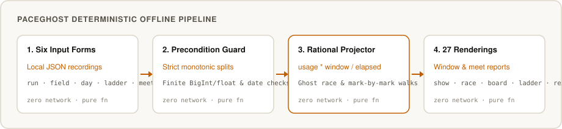

  <picture>
    <source media="(prefers-color-scheme: dark)" srcset="media/paceghost-architecture-dark.svg">
    <source media="(prefers-color-scheme: light)" srcset="media/paceghost-architecture-light.svg">
    
  </picture>

# Paceghost Architecture

Paceghost evaluates recorded agent runs against wall-clock time windows and token/cost budgets without scheduling work or touching live processes. All projections and multi-day statistical summaries execute over exact rationals.

## Four-Stage Pipeline

1. **Whole-file JSON validation (`runs`, `season`, `fieldday`, `ladder`, `rematch`, `meet`, `json`).** Six dedicated loaders validate single runs, model fields, single-window field days, multi-window ladders, two-day rematches, and multi-day meets (`3` to `10` days). Any defect in any nested run or read aborts the entire load with a complete defect list.
2. **Exact rational pacing projection (`pynum`, `fieldday`, `ladder`).** At every positive checkpoint read (`elapsed_seconds > 0`), `paceghost` computes the exact full-window burn projection `usage * window_seconds / elapsed_seconds` as a reduced `BigRational` before any decimal formatting occurs (with `ladder` additionally filtering `elapsed_seconds <= horizon` at each evaluated window cutoff).
3. **Single-walk progression engine (`meet`).** Across multi-day meets, `PG-13` walks every projecting mark in chronological `(day, elapsed_seconds, run_order)` sequence once, recording record-holder handovers, per-competitor standing projections, chaser-pack figures (`index != holder`), and day-close snapshots in one shared pass so all nineteen meet readings stay mathematically locked together.
4. **Twenty-seven deterministic reports (`cli`, `runs`, `season`, `meet`, `pytext`).** Pure renderers format exact figures (`format_usage` to six decimal places, or exact terminating and twelve-place decimals for tiny positive rationals under `FIX-PG-7`, stripping trailing zeros), verify cross-reading invariants, and fence printed labels against line breaks.

## Module Map

| Module | Responsibility |
| --- | --- |
| `rust/src/cli.rs` | Twenty-seven command dispatcher and `-h` / `--help` formatting (`COLUMNS` / Unix `TIOCGWINSZ`) |
| `rust/src/runs.rs` | Single-run loader and `show`, `ghost`, `race`, and `board` report functions |
| `rust/src/season.rs` | Multi-run `field` loader and per-model `season` aggregation against a standing ghost |
| `rust/src/fieldday.rs` | Single-window `fieldday` loader, rational projection engine, and stolen-record progression walk |
| `rust/src/ladder.rs` | Multi-window `ladder` loader evaluating one field day across a list of distinct positive whole-number window cutoffs |
| `rust/src/rematch.rs` | Two-day `rematch` loader and cross-day record handover analyzer |
| `rust/src/meet.rs` | Multi-day `meet` loader, unified progression walk, and nineteen meet trajectory and chaser-field readings |
| `rust/src/pynum.rs` | `BigInt` / `BigRational` conversion, exact quantile arithmetic, and deterministic decimal formatting |
| `rust/src/pytext.rs`, `json.rs`, `scan.rs` | Line-break fencing, depth-bounded JSON parser, and repository codepoint scanner |

## Determinism and Safety Invariants

- **Boundary against `thirdshift`.** `paceghost` is strictly the offline scoreboard and pacing analyst. Scheduling autonomous agent fleets belongs to `thirdshift`, while `paceghost` reads the resulting run logs and computes window projections, stolen records, and distribution statistics.
- **Standing persistence rule (`PG-13`, restated in `PG-17`).** Within a meet progression, once a competitor sets a valid standing projection at a mark, that standing persists across subsequent marks and days until replaced by a later projecting read from the same competitor.
- **Zero floating-point comparisons.** Tie breaks, margins, quartiles, interquartile ranges, midhinges, and midranges compare exact `BigRational` values before formatting, eliminating platform float discrepancies.
