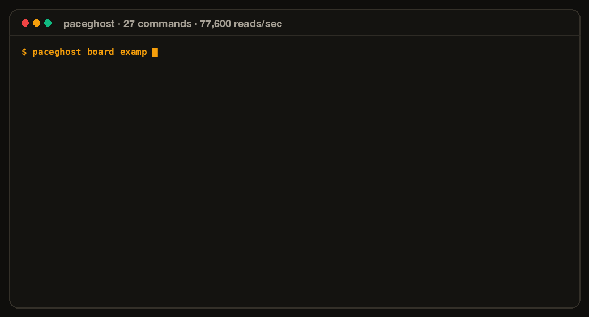

  <picture>
    <source media="(prefers-color-scheme: dark)" srcset="media/paceghost-lockup-dark.svg">
    <source media="(prefers-color-scheme: light)" srcset="media/paceghost-lockup-light.svg">
    
  </picture>

# Paceghost Documentation

Offline agent window-pacing projections, stolen-record progressions, and exact rational meet statistics.

  

## Documentation Map

| Document | What it covers |
| --- | --- |
| [GUIDE.md](guide.md) | Installation, 60-second walkthrough, categorized command matrix, and multi-agent pipeline recipes |
| [ARCHITECTURE.md](architecture.md) | Four-stage processing pipeline, module map, exact arithmetic guarantees, and input fencing |
| [COMPARISON.md](comparison.md) | Spectacle Line 5-tool boundary matrix and comparison against cloud eval SaaS and scripts |
| [PERFORMANCE.md](performance.md) | Measured release binary size, sub-100ms benchmark latencies, and parser memory bounds |
| [FAQ.md](faq.md) | Scope boundaries, exit codes (`0`, `1`, `2`), determinism, and troubleshooting |
| [GUIDE.md#input-file-schemas](guide.md#input-file-schemas) | All six version 1 JSON input shapes (`run`, `field`, `fieldday`, `ladder`, `rematch`, and `meet`) |
| [schemas/](https://github.com/david-engelmann/paceghost/tree/main/schemas) | Draft 2020-12 JSON Schema definitions (`*.schema.json`) for IDE autocomplete and CI validation |
| [completions/](https://github.com/david-engelmann/paceghost/tree/main/completions) | Ready-to-source `bash`, `zsh`, `fish`, and `PowerShell` tab-completion scripts |
| [CONTRACT.md](https://github.com/david-engelmann/paceghost/blob/main/CONTRACT.md) | Normative behavioural specification and numbered round obligations |
| [CHANGELOG.md](https://github.com/david-engelmann/paceghost/blob/main/CHANGELOG.md) | Release history and packaging milestones |

## Design Guarantees

- **Pure offline execution.** `paceghost` makes zero network calls, schedules no work, and mutates none of the recorded run or meet files handed to it.
- **Exact rational projections and quantiles.** Full-window burn projections (`usage * window_seconds / elapsed_seconds`), tie-breaks, quartiles, midhinges, and midranges compute over `BigRational` values before formatting.
- **Whole-input defect reporting.** Any defect in any nested split, checkpoint read, or field day refuses the entire file with a complete defect list before printing a single report line.
- **Single-line output fencing.** Task, phase, model, date, and printed runner labels reject unpaired UTF-16 surrogates and line breaks (`\n` and `\r`) across loaders and report entry points, though untrusted text displayed in a terminal should still pass through a pager or sanitizer.
